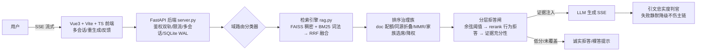

# specqa

**技术规范文档智能问答系统** —— 一个为真实运营而设计、生产就绪（production-ready）的 RAG 全栈项目：语料建库 → 混合检索 → 生成治理 → 流式前端 → 部署 → 成本控制与自动值守的全链闭环。

[](https://github.com/jieliu2026/specqa/actions/workflows/ci.yml) [](LICENSE)

> 本项目由单人主导架构设计与技术决策，AI 编码代理承担大量施工工作——全部决策过程记录于本仓 [决策/](决策/README.md) 的架构决策记录（ADR）。工程实践按生产标准（熔断、门禁、回滚、值守均为真实运行的设计，非简历装饰）；使用规模为口令制小范围（低流量，单人运营——正因为一个人运营，一切必须自动化）。

## 30 秒看懂

- **它做什么**：对垂直领域的规范类文档（技术标准、协议规范、管理规程等文档密集型语料）做检索增强问答——带出处、带引文忠实度校验、证据不足时诚实拒答而不是硬编。
- **为什么不是又一个 RAG demo**：检索侧是**混合检索＋排序治理族＋分层拒答**的完整工程（下详），质量侧有**多卷评测体系＋门禁线＋防自证设计**，运营侧有**成本熔断与自动值守**。
- **全部工程决策与具体语料域无关**（混合检索／排序治理／分层拒答／引文判官／成本熔断均可迁移至任何文档密集型领域）；本系统实际跑在无线通信规范语料上。



## 数字面板

| 维度 | 数值 | 可验证性 |
|---|---|---|
| 公开测试 | **63 件 / 1,340+ 用例全绿**（本仓 CI） | ✅ clone 即验 |
| 完整内部测试 | 95 件 / 3,229 用例 | 内部维护，可应要求演示 |
| 公开评测卷 | 独立 B/C/Y 三卷 48 题（文号已脱敏） | ✅ `建库/scripts/题卷/` |
| 内部语料规模 | 约 6.7 万块语料 / 8.3 万块×1024 维向量 | 内部维护（版权约束不入公开仓） |
| 架构决策记录 | 21 篇 ADR（公开精选见 `决策/`） | 部分公开 |
| 服务规模 | 后端单文件 4,400 行 / 检索引擎 5,300 行 | ✅ 源码在仓 |

## 快速开始

**路径一（无需 API key，验证工程质量）**：

```bash
git clone https://github.com/jieliu2026/specqa && cd specqa
python3 -m venv venv && venv/bin/pip install -r requirements.txt
venv/bin/python -m pytest tests/ -q     # 1,340+ 用例离线全绿
```

**路径二（自带百炼/DashScope key，体验问答）**：

```bash
cp .env.example .env                    # 填 DASHSCOPE_API_KEY
venv/bin/python serve.py                # http://127.0.0.1:8000 直答模式
```

> RAG 检索增强需要向量库：真实生产库约 8.3 万块（版权约束不入公开仓）；demo 语料与一键建库脚本随后续版本提供。检索未启用/未命中时系统自动退直答模式并明示"本次未命中语料"——降级链本身是设计点。

## 核心工程设计（四件最想给你看的）

**1. 混合检索与排序治理族**（`rag.py`）：FAISS 稠密余弦＋BM25 词法（中文 2-gram）经 RRF 融合；其上叠一族排序治理——doc 配额、同源折叠、MMR 多样性、家族选席、去挤占降权——每一项都是为了解决真实检索病（同文档霸屏、同款族挤占、单一视角淹没答案）。

**2. 分层拒答链**：余弦阈值闸（默认 0.40，ROC 标定）→ rerank 行为拒答线 → 证据充分性前置评审。低分与未覆盖不注入语料、明示"通用模型输出"——**答不了的时候说答不了**。

**3. 引文忠实度治理**（`citation_check.py`）：LLM 判官逐源核验回答与出处的一致性；判官失败/超时一律静默降级、绝不阻塞主链路——治理件的第一原则是不伤害可用性。

**4. 成本工程**：嵌入/生成双台账分账、月度预算预警线＋熔断线（过预警打 warn 照常服务、过熔断拒绝嵌入退直答）、费停双闸。运行机制详见 [docs/OPERATIONS.md](docs/OPERATIONS.md)。

质量与评测体系（六卷约 400 题、门禁线、**独立命题防自证设计**）详见 [docs/EVALUATION.md](docs/EVALUATION.md)。

## FAQ

- **为什么 commit 历史不长？** 这是生产系统的公开快照仓，完整开发历史（2026-09 起）在项目方内部的私有仓中——本仓按里程碑重导，不承诺逐提交同步。开发历程见 [docs/OPERATIONS.md](docs/OPERATIONS.md) 时间线。
- **真实使用规模多大？** 口令制小范围、低流量。本项目展示的是**工程实践的生产就绪度**（有熔断、有门禁、有回滚、有值守），不是流量规模。
- **语料为什么不在仓里？** 真实语料受版权约束（内部小范围使用前提）不入公开仓；公开评测卷的文档编号已 surrogate 化处理。

## License

MIT
