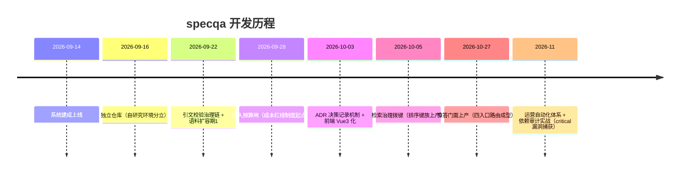

# 生产运营机制（OPERATIONS）

> 本文以机制设计为主线，说明 specqa 生产环境的部署、成本工程与常驻监控自动化。如实标注：**低使用规模——口令制熟人小圈**，机制为超前建设（为质量守护而设，非高并发场景）。

## 一、部署形态

- **云端 ECS + 反向代理四入口路由**：反向代理按路径分发四入口——直答门面（纯生成快答）、查库引用版（RAG+引文核验全链）、workbench（内部工作台）、route（路由演示/探活）。
- **systemd 服务**：常驻服务单元管理（自启/重启策略），进程异常自动拉起。
- **秒级回滚预案**：配置键面单键回退（如 faiss_enabled=false、hybrid 键回 false）+ 部署前备份位 + 前端 dist 移走即回 legacy（软回退秒级）；上产一律取 git 提交态（禁传工作树半成品，由一次事故反证立规）。
- **部署后预检脚本**：`deploy_check.py`（在本仓）——部署后跑冒烟序列（鉴权/会话/RAG/引文面），登底动态化（自动适配口令哈希栈），全过才算部署完成。

## 二、成本工程

- **嵌入/生成双台账分账**：embedding 与 LLM 生成两线各自记账（台账 jsonl 落盘），互不混记、余量各自可见（机制沿革见 [../决策/ADR-0003-成本红线双线分账机制.md](../决策/ADR-0003-成本红线双线分账机制.md)）。
- **月度预算预警线+熔断线（代码内闸）**：过预警线打 warn 照常服务、过熔断线**拒绝嵌入、自动退直答**——成本闸是代码行为而非人工纪律，超线时系统自动降级而非停机。
- **费停双闸**：总额闸（月度累计）+单日闸（防单日异常跑量），两闸独立触发。
- 金额量级：**百元级/月**（定性口径）。

## 三、常驻监控自动化

多个定时自动化单元组成常驻监控面（cron/systemd timer 驱动）：

| 单元 | 频次 | 职责 |
|---|---|---|
| 闭环扫描 | 每 15 分钟 | 查问题台账超期条目，按 A/B/C 级分级推送提醒 |
| 看门狗+心跳 | 每日 | 服务存活/端点可用性巡检与心跳上报 |
| 费面板重算 | 每日 | 双台账余额重算、预警/熔断线距离刷新 |
| 依赖审计 | 每月 | 生产依赖漏洞审计——**实战战果**：曾捕获生产依赖 critical 漏洞并真实发出红灯通知（非演练） |

**问题台账闭环分级处理**（"发现"必须随产登记，未落账=交付不合格；闭环=处理后再告知，不是告知后等待）：

- **A 级**（已授权/低风险可回滚）：自行处理到底（修/升/测/按窗口部署），完成后通知结果+证据+回滚点。
- **B 级**（有明确默认推荐且影响可控可逆）：按默认执行后告知"已按默认办，不同意可回滚"。
- **C 级**（生产主链/对外通信/不可逆/花钱/窗口级）：备齐方案待作者一词评审，呈报位可见+超期自动升级。

## 四、开发历程时间线

## 五、快照锚定声明

**本仓为生产系统的公开快照**：代码与文档锚定快照时点的系统形态；完整运营档（台账原始件、runbook、问题台账、自动化脚本运行记录）由项目方在内部维护，可应要求演示。
